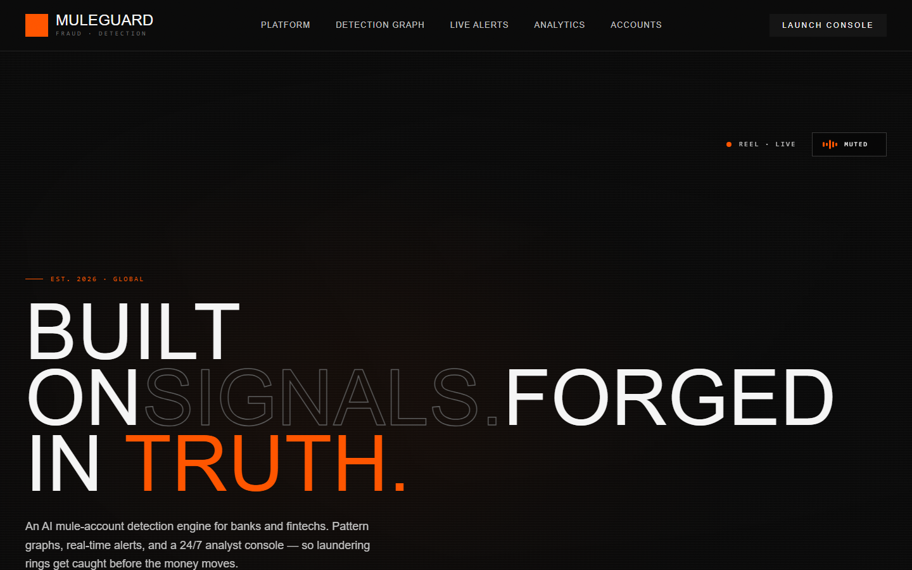

# MuleGuard

**Follow the money through the network.**

MuleGuard is a mule-account detection cockpit for transaction graphs. It combines graph features, an XGBoost risk model and behavioural state transitions, then shows analysts where money enters, where it pools and where it leaves.

[Live demo](https://mule-detection.vercel.app) · [Detection engine](src/lib/detectionEngine.ts) · [Model](model_weights.json)



## Problem

Mule accounts do not look like a single bad transaction. They look like a pattern:

- Many unrelated senders feed one account.
- The account forwards funds to many receivers.
- Money loops through a short chain and returns.
- A dormant account wakes up for one large pass-through.
- Amounts are split to stay under reporting thresholds.

Rules catch individual events. They miss the topology that makes a mule ring visible.

## Solution

MuleGuard turns accounts and transactions into a risk surface with three views:

- **3D account galaxy** for cluster and hub exploration (`MuleGalaxy.tsx`, `3d-force-graph`).
- **Network graph** for direct counterparties and money-flow paths (`NetworkGraph.tsx`, `vis-network`).
- **Sankey view** for aggregate flow between account groups (`SankeyGraph.tsx`).

On top of the graph:

- Risk-ranked accounts, alerts and an analyst dashboard.
- XGBoost scoring with graph and behavioural features.
- Markov behavioural states for `legitimate → suspicious → confirmed_mule` transitions.
- Detection explanations and analyst report generation.
- Firebase Admin persistence with server-side API routes.
- Firestore rules that deny direct client reads and writes.

## Proof

- **105,461 synthetic accounts** in the bundled demo dataset (`public/accounts_dataset.json`).
- **87,613 accounts** in the engineered training feature set (`backend/ml_features_100k.csv`).
- **16 graph and behavioural features** per account, including PageRank, hub/authority score, pass-through ratio, transaction velocity and mode entropy.
- **200-tree XGBoost model** exported to JSON (`model_weights.json`) and executed by a TypeScript tree-traversal predictor in the browser/server runtime.
- **Deterministic fallback scoring** when the model file is missing or malformed.
- **Server-side write protection** through optional route tokens (`src/lib/apiAuth.ts`).
- **Firestore client access denied** by rules; all data access goes through API routes.

No accuracy or precision claim is made here. The model was trained on synthetic data and has not been validated against a bank's production labels.

## How it works

```text
accounts + transactions
  → graph construction
  → feature extraction
  → XGBoost score + graph signals + Markov state
  → calibrated risk band
  → alerts, explanations, analyst report
  → Firestore / local dataset
```

The core engine is `src/lib/detectionEngine.ts`. It builds graph metrics, runs the model predictor, applies behavioural rules, and produces risk scores and explanations. The Next.js API routes expose detection, seed, graph and local-data endpoints. The Python backend contains the data generation and training scripts.

## Technology

- Next.js, React, TypeScript, Tailwind CSS
- `3d-force-graph`, `vis-network`, Three.js
- Plotly, Recharts
- XGBoost, scikit-learn, pandas, NetworkX
- FastAPI and Flask scripts for the Python backend
- Firebase Admin, Firestore
- Vercel

## Demo

Live: **https://mule-detection.vercel.app**

The demo uses synthetic data only. The first load can be slow because the bundled account dataset is large; the data route caches it after the first parse.

## Run locally

Frontend:

```bash
npm install
npm run dev
```

Open http://localhost:3000.

Optional Firebase environment variables are documented in `.env.example`. Without Firebase configuration, the app falls back to the bundled local dataset.

Python backend:

```bash
cd backend
python -m venv .venv
.venv\Scripts\activate
pip install -r requirements.txt
python build_realistic_hard_dataset.py
uvicorn main:app --reload
```

`build_realistic_hard_dataset.py` regenerates the synthetic accounts, features and model. The Flask app (`app.py`) additionally expects `transactions_1m.csv`; regenerate it before running that path.

## Limitations

- The data is synthetic. The model is not validated on real bank labels, and no production fraud rate is claimed.
- There is no automated test suite in this repository yet.
- The repository is large because it includes generated datasets and model artifacts. The deployed demo can take time to warm up.
- The `frontend/` directory is an older copy of the app; the root Next.js application is the active surface.
- Firebase persistence requires service-account configuration. Without it, the demo runs from the local dataset.
- This is a decision-support prototype, not a regulated fraud system.

## Repository layout

```text
src/app/                  Next.js routes and API endpoints
src/components/           Dashboard, galaxy, graph, Sankey and analytics UI
src/lib/                  Detection engine, XGBoost predictor, Markov model, Firebase
backend/                  Synthetic data generation and XGBoost training
public/accounts_dataset.json
model_weights.json        Exported XGBoost trees for client/server inference
RESEARCH_PAPERS/          Background research notes
SIH_AUDIT_REPORT.md       Security and deployment audit
```

## Author

Swapneel Sethi · [GitHub](https://github.com/Swapneel-Sethi)
